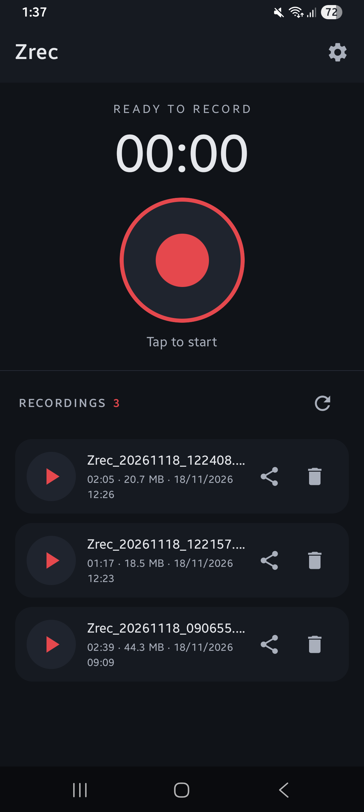
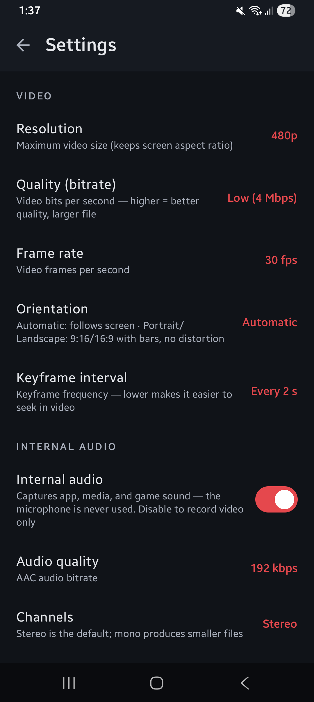

# Zrec

**Screen recorder for Android with internal audio capture — no microphone involved.**

Zrec records your screen and the device's internal audio (app, media and game sound) into a single MP4 file, saved straight to `Movies/Zrec` where it shows up in any gallery app. Built with Kotlin and Jetpack Compose.

## Screenshots

| Main | Settings |
|------|----------|
|  |  |

## Features

- **Internal audio capture** via `AudioPlaybackCaptureConfiguration` — the microphone is never used
- **Screen + audio in one MP4** — MediaProjection → VirtualDisplay → MediaCodec (H.264) and AudioRecord → MediaCodec (AAC), muxed with MediaMuxer
- **Recording list** built into the app: play, share and delete recordings without leaving Zrec
- **Foreground service** (`mediaProjection` type) with a persistent notification and a stop action, so recording continues in the background
- **Fully configurable**: resolution, bitrate, frame rate, orientation (auto / portrait / landscape with bars), keyframe interval, audio bitrate, channels (stereo/mono), sample rate, keep-screen-on, haptic feedback
- **Material 3** dark UI, edge-to-edge, English and Portuguese (Brazil) localizations
- **No storage permission needed** — output is written through MediaStore directly into `Movies/Zrec`

## Requirements

- Android 10 (API 29) or newer — required for internal audio capture
- `RECORD_AUDIO` permission (mandated by Android for playback capture, even though the mic is never used)
- Screen capture consent via the system MediaProjection dialog

## Building

```bash
./gradlew assembleDebug
```

The APK is generated at `app/build/outputs/apk/debug/app-debug.apk`.

> Note: on aarch64 Linux hosts you may need to point Gradle at a working `aapt2` binary via `android.aapt2FromMavenOverride` in `gradle.properties` (see the comment in that file).

## How it works

```
MediaProjection ──► VirtualDisplay ──► MediaCodec (H.264, surface) ─┐
MediaProjection ──► AudioPlaybackCaptureConfiguration ──► AudioRecord ┤
                                                                      ▼
                              AudioRecord ──► MediaCodec (AAC) ──► MediaMuxer ──► MediaStore (Movies/Zrec)
```

- `RecordingEngine` — capture pipeline (video + audio encoders, muxer, MediaStore output)
- `RecordingService` — foreground service, notification, screen-off handling
- `RecorderScreen` / `SettingsScreen` — Jetpack Compose UI
- `Settings` — persisted preferences (DataStore-free, SharedPreferences-backed)

## Tech stack

Kotlin · Jetpack Compose (Material 3) · MediaProjection · MediaCodec · MediaMuxer · MediaStore · Foreground Service

## License

MIT — see [LICENSE](LICENSE).

## Release signing

Release builds are signed via properties that are **never committed**. Set them in `~/.gradle/gradle.properties` or as environment variables:

```properties
ZREC_KEYSTORE_PATH=/path/to/zrec-release.jks
ZREC_KEYSTORE_PASSWORD=...
ZREC_KEY_ALIAS=zrec
ZREC_KEY_PASSWORD=...
```

Then build:

```bash
./gradlew assembleRelease bundleRelease
```
